<div align="center">


# FreeSizeTree

**Speicherplatz-Analyse für Windows: Finde heraus, was deine Festplatte füllt, und räum in Minuten auf.**

Sunburst & Treemap, Aufräum-Tipps mit Ein-Klick-Bereinigung, alle Spiele aus Steam, Epic, EA, Rockstar, Xbox & Co., installierte Programme und Duplikate – in einer schnellen, modernen Oberfläche.

[**⬇ Download (neueste Version)**](../../releases/latest) · [Funktionen](#funktionen) · [Installation](#installation) · [Bauen](#selbst-bauen) · [Mitmachen](#mitmachen)

[](https://github.com/nils-kt/FreeSizeTree/actions/workflows/ci.yml)
[](../../releases/latest)


[](LICENSE)

<br>

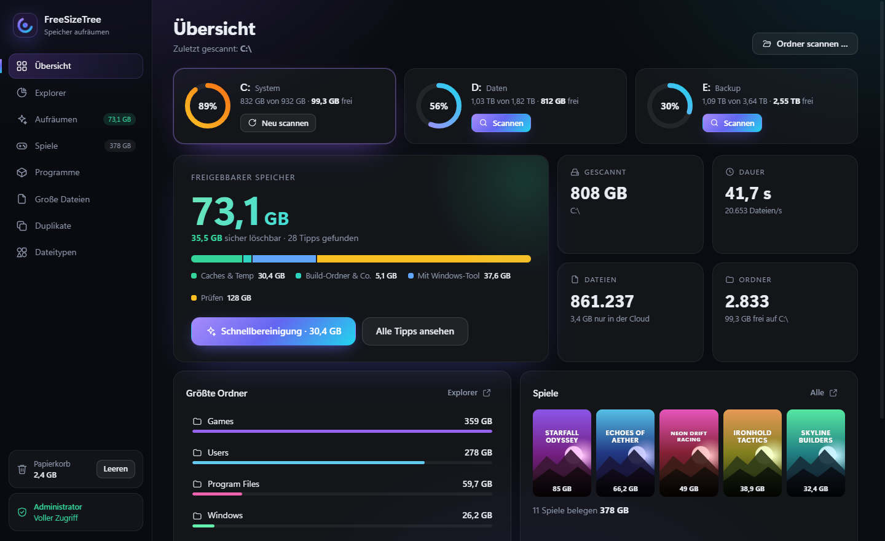

</div>

---

## Funktionen

### Scannen in Sekunden

Laufwerk wählen, auf **Scannen** klicken – FreeSizeTree liest alle Ordner mit bis zu 16 Threads parallel ein. Über eine Million Dateien sind meist in unter einer Minute erfasst. Danach zeigt die Übersicht sofort, wie viel Speicher sich freigeben lässt, aufgeteilt in *Caches & Temp*, *Build-Ordner*, *Mit Windows-Tool* und *Prüfen*.

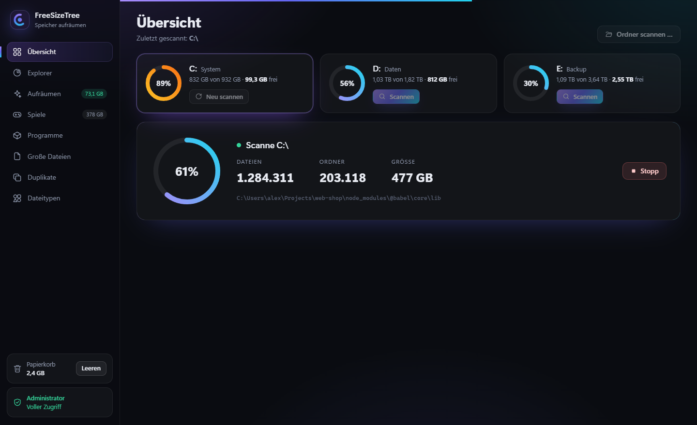

### Explorer: Sunburst & Treemap

Sieh auf einen Blick, wo der Platz hingeht. Ein Klick zoomt in einen Ordner, die Mitte führt zurück, Rechtsklick öffnet die Aktionen (im Explorer zeigen, Pfad kopieren, neu scannen, löschen). Daneben die Liste mit Anteilsbalken, filterbar per Suche.

<table>
<tr>
<td width="50%">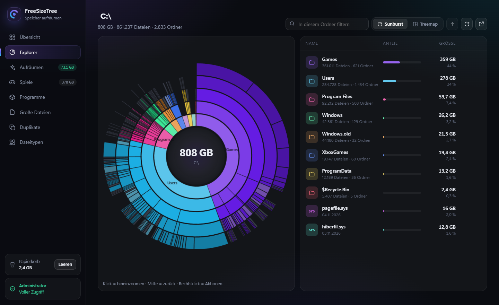</td>
<td width="50%">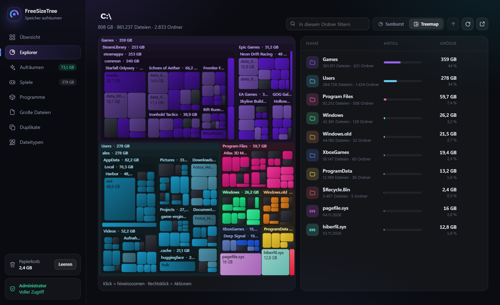</td>
</tr>
</table>

### Aufräumen mit Verstand

FreeSizeTree kennt die typischen Platzfresser und sagt dir bei jedem Fund, **ob** und **wie** du ihn loswirst:

| Einschätzung | Beispiele | Aktion |
|---|---|---|
| 🟢 **Sicher löschbar** | Papierkorb, Temp-Ordner, App- und Browser-Caches, npm/pip/uv/NuGet/Gradle-Caches, Absturzberichte, `node_modules`, Rust-`target`, `.next` | Ein Klick |
| 🔵 **Mit Windows-Tool** | `Windows.old`, Update-Cache, Wiederherstellungspunkte, `hiberfil.sys` | Öffnet die passende Windows-Einstellung |
| 🟡 **Prüfen** | Downloads, WSL-/Docker-Festplatten (`.vhdx`), KI-Modelle (Hugging Face, Ollama), Disk-Images, sehr große Archive | Anzeigen & selbst entscheiden |
| 🔴 **Nicht löschen** | `WinSxS`, `Windows\Installer`, `pagefile.sys` | Nur Info + offizieller Weg zum Verkleinern |

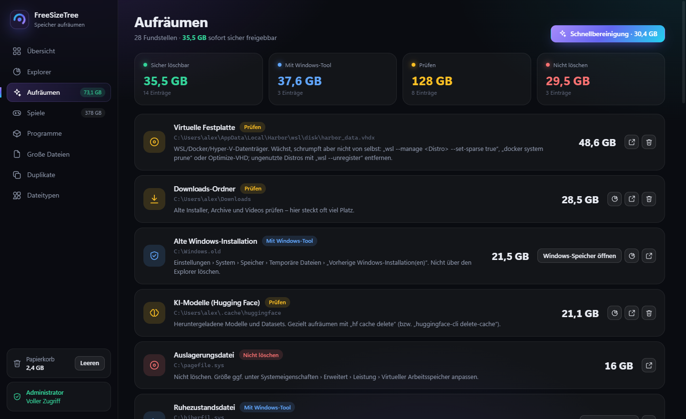

<table>
<tr>
<td width="52%">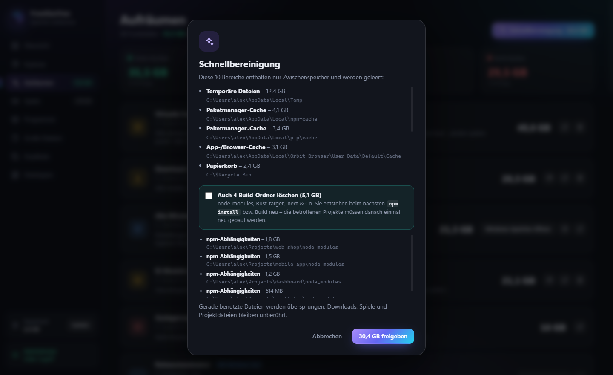</td>
<td>

**Schnellbereinigung**

- leert Papierkorb, Temp-Ordner und reine Caches
- Build-Ordner (`node_modules`, `target`, `.next` …) nur mit ausdrücklichem Häkchen
- gerade benutzte Dateien werden übersprungen
- Downloads, Spiele und Projektdateien bleiben unberührt

</td>
</tr>
</table>

### Spiele aus allen Launchern

**Steam** (alle Bibliotheken), **Epic Games**, **GOG**, **EA app**, **Rockstar**, **Battle.net**, **Ubisoft Connect**, **Riot**, **Amazon Games** und **Xbox / Microsoft Store** – mit echter Größe, Cover, Shader-Cache und Workshop-Inhalten. Spiele, die du **seit über 6 Monaten nicht gespielt** hast, werden hervorgehoben. Deinstalliert wird sauber über den jeweiligen Launcher.

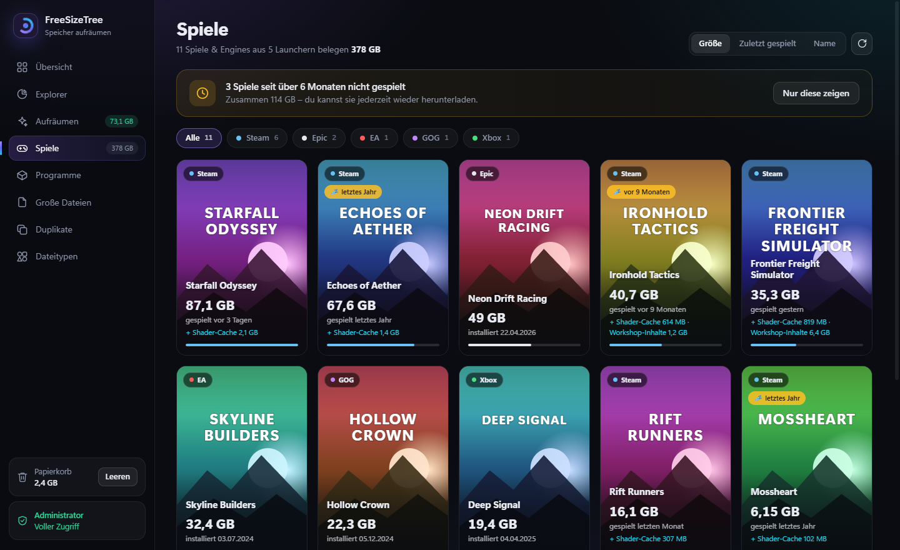

### Programme

Alle installierten Programme mit Icon, Version, Installationsdatum und **gemessener** Größe. Deinstallieren startet das Programm des Herstellers. Einträge, deren Ordner gar nicht mehr existiert, werden als **verwaist** markiert.

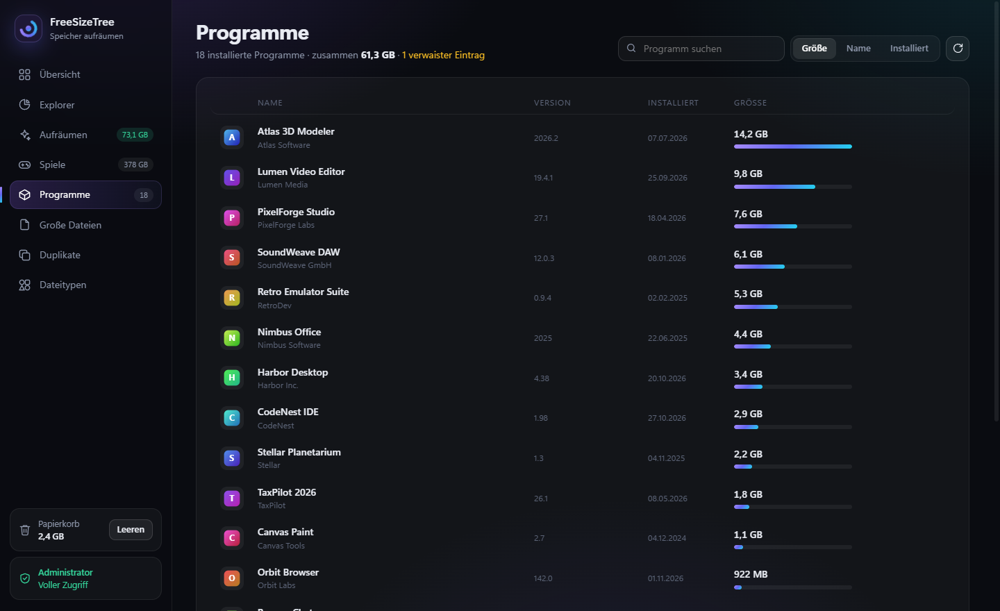

### Große Dateien, Duplikate, Dateitypen

<table>
<tr>
<td width="50%">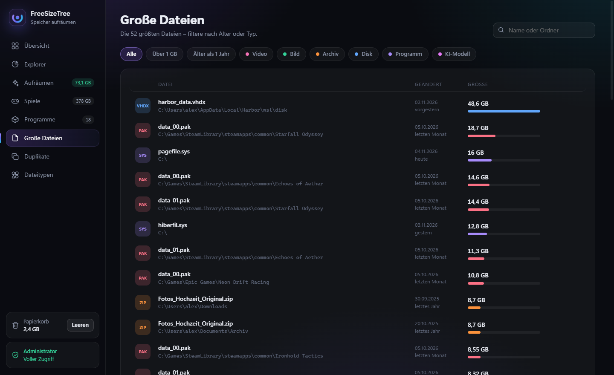</td>
<td width="50%">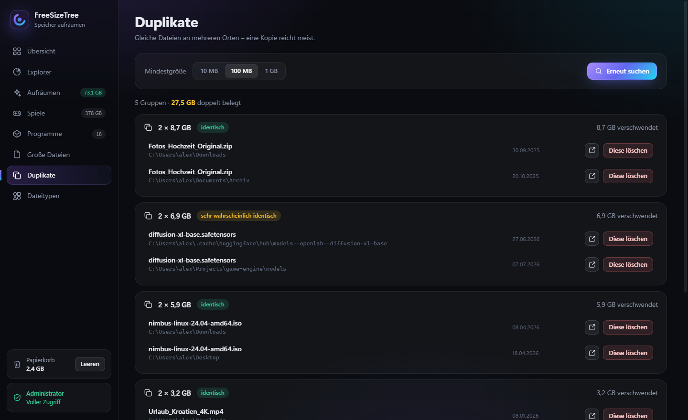</td>
</tr>
<tr>
<td>Die 3000 größten Dateien – filterbar nach <b>Alter</b> (älter als ein Jahr), Größe und Typ: Video, Archiv, Disk-Image, Programm, KI-Modell …</td>
<td><b>Duplikate</b> per Größe und SHA-256-Prüfsumme (ab 10 MB, 100 MB oder 1 GB) – mit „Diese löschen“ pro Kopie.</td>
</tr>
</table>

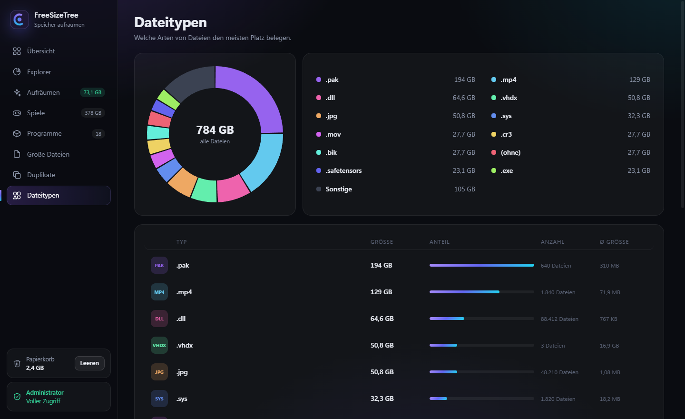

> Alle Bilder zeigen einen **fiktiven Demo-PC** – Spiele, Programme und Ordner sind frei erfunden. Siehe [README-Bilder neu rendern](#readme-bilder-neu-rendern).

## Installation

1. Lade die passende ZIP-Datei aus den [**Releases**](../../releases/latest) herunter:
   - `FreeSizeTree-x.y.z-win-x64.zip`: eigenständig, keine Installation nötig (empfohlen)
   - `FreeSizeTree-x.y.z-win-arm64.zip`: für Windows auf ARM
   - `FreeSizeTree-x.y.z-win-x64-requires-dotnet10.zip`: sehr klein, benötigt die [.NET 10 Desktop Runtime](https://dotnet.microsoft.com/download/dotnet/10.0)
2. Entpacken und `FreeSizeTree.exe` starten.
3. Laufwerk wählen und **Scannen** klicken.

Die Oberfläche nutzt die [Microsoft Edge WebView2 Runtime](https://developer.microsoft.com/microsoft-edge/webview2/). Unter Windows 11 ist sie vorinstalliert.

> **Tipp:** Über **Admin** unten links startet FreeSizeTree mit Administratorrechten neu. Dann werden auch geschützte Systemordner und die Profile anderer Benutzer mitgezählt.

### Kommandozeile

| Aufruf | Wirkung |
|---|---|
| `FreeSizeTree.exe` | Startet die App |
| `FreeSizeTree.exe --scan C:\` | Startet die App und scannt sofort `C:\` |
| `FreeSizeTree.exe --page games` | Öffnet direkt eine Seite: `overview`, `explorer`, `cleanup`, `games`, `apps`, `files`, `dupes`, `types` |
| `FreeSizeTree.exe --demo` | Zeigt die Oberfläche mit dem fiktiven Demo-PC (es wird nichts gescannt oder gelöscht) |
| `FreeSizeTree.exe --report C:\ bericht.txt` | Scannt ohne Oberfläche und schreibt einen Textbericht |
| `FreeSizeTree.exe --render-docs <ordner>` | Rendert die README-Bilder (siehe unten) |
| `FreeSizeTree.exe --dev` | Aktiviert die Entwicklertools der Oberfläche (F12) |

## Sicherheit: Was wird gelöscht?

FreeSizeTree löscht **nie etwas ohne Bestätigung**. Jeder Dialog zeigt Pfad und Größe. Der Fokus liegt dort immer auf „Abbrechen“, und Bestätigungen werden erst nach einer kurzen Verzögerung angenommen – ein versehentlicher Doppelklick oder Enter löscht also nichts.

- Die **Schnellbereinigung** leert Papierkorb, Temp-Ordner und reine Cache-Ordner. Build-Ordner kommen nur per Häkchen dazu.
- **Mit Windows-Tool**-Einträge öffnen die Windows-Speichereinstellungen, statt Systemdateien direkt anzufassen.
- **Nicht löschen**-Einträge haben keinen Lösch-Knopf.
- In System- und Programmordnern erscheint beim Löschen eine zusätzliche Warnung.
- Spiele und Programme werden über den **Launcher bzw. das Deinstallationsprogramm des Herstellers** entfernt, nicht durch Löschen des Ordners.
- Was in den Papierkorb wandert, belegt weiter Platz, bis der Papierkorb geleert wird.

## Datenschutz

- Keine Telemetrie, keine Konten, keine Cloud – alles bleibt auf deinem Rechner.
- Einzige Internetverbindung: Fehlt bei einem Steam-Spiel das Cover im lokalen Steam-Cache, wird es vom Steam-CDN geladen.
- Die Oberfläche läuft in einer lokalen WebView2-Instanz und kann keine fremden Seiten öffnen. Ihre Daten liegen unter `%LOCALAPPDATA%\FreeSizeTree`.

## Selbst bauen

Voraussetzungen: Windows 10/11 und das [.NET 10 SDK](https://dotnet.microsoft.com/download/dotnet/10.0).

```bash
git clone https://github.com/nils-kt/FreeSizeTree.git && cd FreeSizeTree
dotnet build
dotnet run
```

Eine einzelne, eigenständige EXE baust du so:

```bash
dotnet publish -c Release -r win-x64 --self-contained true -p:PublishSingleFile=true -p:IncludeNativeLibrariesForSelfExtract=true -o dist
```

### README-Bilder neu rendern

Die Bilder in [`docs/images`](docs/images) sind **keine Screenshots von echten Daten**. FreeSizeTree rendert sie selbst aus der echten Oberfläche, gefüllt mit einem fiktiven Demo-PC ([`DemoData.cs`](DemoData.cs)). Im Demo-Modus sind alle Aktionen gesperrt, die etwas löschen oder öffnen. Nach UI-Änderungen genügt:

```bash
dotnet run -- --render-docs docs/images
```

Die CI rendert die Bilder bei jedem Push ebenfalls und hängt sie als Artefakt an. So fällt sofort auf, wenn eine Seite nicht mehr lädt.

### Release erstellen

Releases baut [GitHub Actions](.github/workflows/release.yml) automatisch, sobald ein Versions-Tag gepusht wird:

```bash
git tag v2.0.0
git push origin v2.0.0
```

Der Workflow erstellt die drei ZIP-Varianten (x64, ARM64, framework-abhängig) samt `SHA256SUMS.txt` und veröffentlicht ein GitHub-Release mit automatisch erzeugten Release-Notes. Tags mit Bindestrich (z. B. `v2.1.0-beta.1`) werden als Pre-Release veröffentlicht.

## Projektaufbau

```text
Program.cs          Einstieg, Kommandozeile
AppWindow.cs        Fenster mit WebView2, liefert die Oberfläche über https://app.local/ aus
Bridge.cs           Schnittstelle Oberfläche ↔ C# (Befehle, Antworten, Live-Events)
Scanner.cs          Paralleler Verzeichnis-Scan
Model.cs            Ordnerbaum, Größen, Baum-Operationen
CleanupAdvisor.cs   Regeln für die Aufräum-Tipps
Cleaner.cs          Robustes Löschen (überspringt gesperrte Dateien)
Games.cs            Launcher-Erkennung (Steam-VDF, Epic-Manifeste, Registry)
Apps.cs             Installierte Programme aus der Windows-Registry
Dupes.cs            Duplikatsuche
DemoData.cs         Fiktiver Demo-PC für --demo und die README-Bilder
DocRenderer.cs      Rendert die README-Bilder (--render-docs)
Report.cs           Textbericht (--report)
Native.cs           Windows-APIs (Papierkorb, Titelleiste)
www/                Oberfläche: index.html, app.css, app.js (ohne Framework)
```

**So funktioniert der Scan:** Mehrere Threads arbeiten eine gemeinsame Ordner-Warteschlange ab, jeder Ordner wird genau einmal gelesen. Kleine Dateien werden nur gezählt; Dateien ab 1 MB werden einzeln gemerkt (für Treemap, große Dateien und Duplikate). Danach werden die Größen von unten nach oben aufsummiert. Junctions und symbolische Links werden nicht verfolgt, damit nichts doppelt zählt; OneDrive-Dateien, die nur in der Cloud liegen, zählen mit 0 Byte.

## Bekannte Einschränkungen

- Ohne Administratorrechte fehlen einige Systemordner in der Statistik.
- Hardlinks (vor allem in `C:\Windows\WinSxS`) werden mehrfach gezählt – die echte Belegung ist dort kleiner.
- Epic Games bietet keine direkte Deinstallation per Link; FreeSizeTree öffnet dafür den Epic Games Launcher.
- Die Oberfläche ist derzeit nur auf Deutsch verfügbar.

## Mitmachen

Fehler gefunden oder eine Idee für eine neue Aufräum-Regel? Erstelle gern ein [Issue](../../issues) oder einen Pull Request.

- Neue Aufräum-Regeln kommen in [`CleanupAdvisor.cs`](CleanupAdvisor.cs) – bitte immer begründen, warum der Ordner gefahrlos gelöscht werden kann.
- Neue Launcher kommen in [`Games.cs`](Games.cs).
- Nach Änderungen an der Oberfläche bitte die README-Bilder neu rendern.

## Lizenz

FreeSizeTree steht unter der [MIT-Lizenz](LICENSE). Du darfst den Code frei nutzen, verändern und weitergeben – auch kommerziell –, solange der Lizenzhinweis erhalten bleibt. Die Software wird ohne Gewährleistung bereitgestellt.

---

<sub>Steam, Epic Games, GOG, EA, Rockstar Games, Battle.net, Ubisoft Connect, Riot Games, Amazon Games und Xbox sind Marken ihrer jeweiligen Inhaber. FreeSizeTree ist ein unabhängiges Projekt und steht in keiner Verbindung zu diesen Unternehmen. Alle in den Bildern gezeigten Spiele, Programme und Namen sind frei erfunden.</sub>
